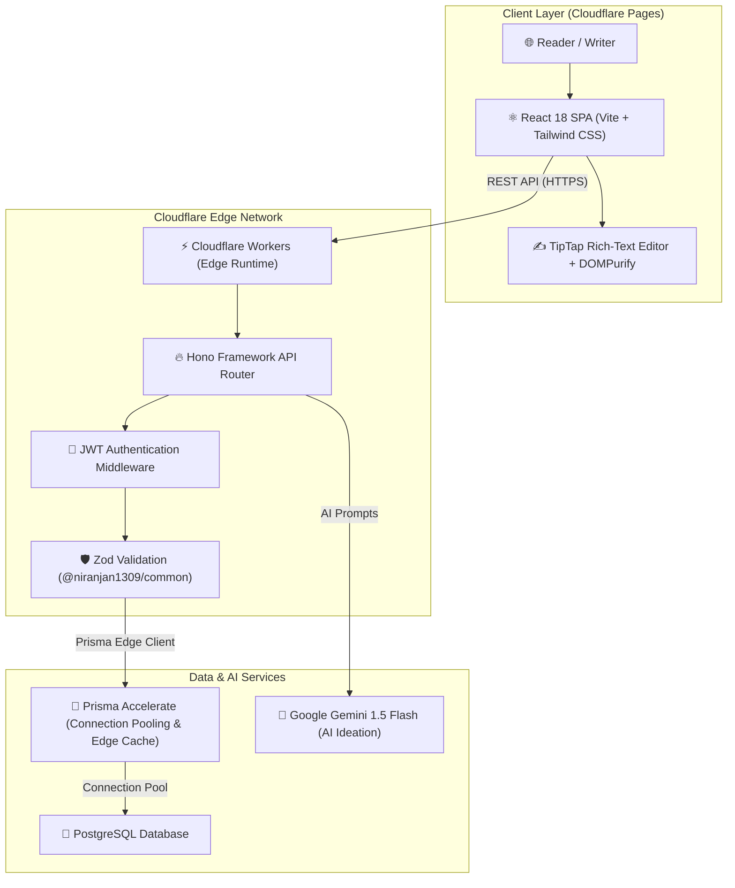

# High Blogs 🚀

<div align="center">

[](https://high-blogs.pages.dev/)
[](https://workers.cloudflare.com/)
[](https://hono.dev/)
[](https://react.dev/)
[](https://www.typescriptlang.org/)
[](https://www.prisma.io/accelerate)
[](https://tailwindcss.com/)
[](https://opensource.org/licenses/MIT)

**A sub-50ms global edge-rendered developer blogging platform designed for blazing speed, focused writing, and AI-assisted creativity.**

[Explore Live Demo](https://high-blogs.pages.dev/) · [Report Bug](https://github.com/NIRONMAN/High-Blogs/issues) · [Request Feature](https://github.com/NIRONMAN/High-Blogs/issues)

</div>

---

## ⚡ Overview

**High Blogs** is a modern, high-performance publishing platform inspired by Medium, engineered from the ground up for edge computing. Built with **Cloudflare Workers** and the lightweight **Hono** framework, it delivers sub-50ms API response times across Cloudflare's 300+ global edge locations. 

With end-to-end type safety guaranteed by a shared Zod validation package, Prisma Accelerate connection pooling over PostgreSQL, a distraction-free TipTap rich text editor, and an integrated Google Gemini AI writing assistant, High Blogs provides authors with an uncompromising developer experience and reader-first performance.

### 🌐 Live Application
Experience the live application hosted on Cloudflare Pages:  
👉 **[https://high-blogs.pages.dev/](https://high-blogs.pages.dev/)**

---

## 🏗️ System Architecture

High Blogs decouples frontend presentation from edge execution and database persistence, routing all requests through a low-latency edge pipeline:



---

## ✨ Key Features

- **⚡ Sub-50ms Global Edge Runtime**: The entire backend runs on Cloudflare Workers with Hono, completely eliminating cold starts and routing requests to the nearest edge node worldwide.
- **🔄 End-to-End TypeScript Safety**: A unified monorepo model where schemas (`signupInput`, `signinInput`, `createBlogInput`, `updateBlog`) in `common/` (published as `@niranjan1309/common`) power both compile-time client types and runtime server validation.
- **🚀 Edge Connection Pooling**: Resolves serverless connection exhaustion on PostgreSQL by using Prisma Client Edge coupled with **Prisma Accelerate** for connection pooling and caching.
- **🔐 Stateless JWT Authentication**: Secure authentication middleware running entirely on the edge, verifying bearer tokens and binding the user session directly into the Hono execution context.
- **✍️ Distraction-Free Rich Text Editor**: Integrated TipTap editor featuring heading toggles (H1, H2, H3), bold/italic styling, code blocks, and ordered/bullet lists.
- **🛡️ Comprehensive XSS Protection**: All user-generated content and AI outputs are sanitized on both write and read paths using `DOMPurify`.
- **💡 AI Writer's Helper**: Overcomes writer's block with real-time prompt generation powered by **Google Gemini 1.5 Flash**, offering contextual title and content suggestions.
- **🎨 Modern Dark UI**: Crafted with Tailwind CSS and Lucide React icons for a clean, sleek, responsive aesthetic.

---

## 🧰 Tech Stack

| Layer | Technology | Description |
| :--- | :--- | :--- |
| **Frontend** | [React 18](https://react.dev/) | Component-driven user interface with hooks and router |
| **Bundler & Tooling** | [Vite 5](https://vitejs.dev/) | Ultra-fast HMR and optimized production bundling |
| **Styling** | [Tailwind CSS](https://tailwindcss.com/) | Modern utility-first responsive styling with dark theme |
| **Rich Text Editor** | [TipTap](https://tiptap.dev/) | Headless, extensible ProseMirror-based rich text editor |
| **Sanitization** | [DOMPurify](https://github.com/cure53/DOMPurify) | Client-side DOM sanitization preventing XSS attacks |
| **Backend Runtime** | [Cloudflare Workers](https://workers.cloudflare.com/) | V8 isolates edge runtime executing globally |
| **Backend Framework**| [Hono](https://hono.dev/) | Lightweight, ultra-fast web framework tailored for edge |
| **Database ORM** | [Prisma Edge](https://www.prisma.io/) | Next-generation edge ORM client with schema migrations |
| **Connection Pooling**| [Prisma Accelerate](https://www.prisma.io/accelerate) | Global connection pooler and cache for serverless PostgreSQL |
| **Database** | [PostgreSQL](https://www.postgresql.org/) | Relational database storing users, posts, and relations |
| **Type Validation** | [Zod](https://zod.dev/) | Schema declaration and validation library in `common/` |
| **AI Integration** | [Google Gemini 1.5 Flash](https://ai.google.dev/) | Generative AI assisting with writer prompts and ideation |
| **Hosting & CI/CD** | [Cloudflare Pages](https://pages.cloudflare.com/) | Git-integrated global CDN hosting for the SPA frontend |

---

## 📁 Repository Structure

```text
High-Blogs/
├── Backend/                    # Cloudflare Workers + Hono REST API
│   ├── prisma/
│   │   └── schema.prisma       # PostgreSQL schema (User & Post models)
│   ├── routes/
│   │   ├── blogRouter.ts       # Blog CRUD routes & Gemini AI endpoint
│   │   └── userRouter.ts       # Authentication routes (signup / signin)
│   ├── src/
│   │   └── index.ts            # Hono application entry & CORS middleware
│   ├── package.json            # Backend scripts and dependencies
│   └── tsconfig.json           # Cloudflare Workers TypeScript configuration
│
├── Frontend/                   # React 18 + Vite SPA
│   ├── public/                 # Static assets and icons
│   ├── src/
│   │   ├── components/         # UI components & Views
│   │   │   ├── Appbar.tsx      # Navigation header with auth actions
│   │   │   ├── CreateBlog.tsx  # Blog composition with AI helper sidebar
│   │   │   ├── TipTapEditor.tsx# Rich text editor configuration
│   │   │   ├── Toolbar.tsx     # Rich text formatting controls (code, headings)
│   │   │   ├── ViewBlog.tsx    # Sanitized article reading view
│   │   │   ├── BlogWrapper.tsx # Feed container and blog list view
│   │   │   ├── Signin.tsx      # User authentication screen
│   │   │   ├── Signup.tsx      # Account creation screen
│   │   │   └── Landing.tsx     # Hero landing presentation
│   │   ├── App.tsx             # Route definitions (react-router-dom)
│   │   ├── main.tsx            # React application entry point
│   │   └── index.css           # Tailwind base styles
│   ├── package.json            # Frontend scripts and dependencies
│   ├── tailwind.config.js      # Tailwind CSS configuration
│   └── vite.config.ts          # Vite configuration
│
└── common/                     # Monorepo shared module (@niranjan1309/common)
    ├── src/
    │   └── index.ts            # Shared Zod schemas and inferred TS types
    ├── package.json            # Module configuration (published to npm)
    └── tsconfig.json           # TypeScript build config
```

---

## 📡 API Reference

Base Path: `/api/v1`

### 👤 User Endpoints

| Method | Route | Description | Auth Required | Request Body |
| :--- | :--- | :--- | :---: | :--- |
| `POST` | `/api/v1/user/signup` | Register new user account | No | `{ email, name, password }` |
| `POST` | `/api/v1/user/signin` | Authenticate user & return JWT | No | `{ email, password }` |

### 📝 Blog Endpoints

| Method | Route | Description | Auth Required | Request Body |
| :--- | :--- | :--- | :---: | :--- |
| `GET` | `/api/v1/blog/bulk` | Retrieve all blog posts | No | None |
| `GET` | `/api/v1/blog/:id` | Retrieve single post by ID | No | None |
| `POST` | `/api/v1/blog` | Publish a new blog post | Yes (`Bearer <token>`) | `{ title, content, imageLink }` |
| `PUT` | `/api/v1/blog` | Update an existing blog post | Yes (`Bearer <token>`) | `{ id, title, content }` |
| `POST` | `/api/v1/blog/ai` | Generate creative blog ideas | Yes (`Bearer <token>`) | `{ prompt }` |

---

## 🚀 Local Development Guide

### Prerequisites

- [Node.js](https://nodejs.org/) (v18.0.0 or later)
- [npm](https://www.npmjs.com/) or [pnpm](https://pnpm.io/)
- [Wrangler CLI](https://developers.cloudflare.com/workers/wrangler/install-and-update/): `npm install -g wrangler`
- A PostgreSQL database instance (e.g., [Neon](https://neon.tech/), [Supabase](https://supabase.com/), or [Aiven](https://aiven.io/))
- A [Prisma Accelerate](https://www.prisma.io/accelerate) connection string (`prisma://accelerate.prisma-data.net/?api_key=...`)
- A [Google Gemini API Key](https://ai.google.dev/) (for AI writing assistant)

---

### Step 1: Clone the Repository

```bash
git clone git@github.com:NIRONMAN/High-Blogs.git
cd High-Blogs
```

---

### Step 2: Setup the Shared Module

The shared module contains cross-stack Zod schemas and TypeScript interfaces:

```bash
cd common
npm install
npm run build
cd ..
```

---

### Step 3: Backend Setup (Cloudflare Workers)

1. Navigate to the backend directory and install dependencies:
   ```bash
   cd Backend
   npm install
   ```

2. Configure environment variables for local edge simulation:
   Create a `.dev.vars` file in `Backend/`:
   ```env
   DATABASE_URL="prisma://accelerate.prisma-data.net/?api_key=YOUR_PRISMA_ACCELERATE_KEY"
   JWTSECRET="your-super-secret-jwt-key"
   API_KEY="your-google-gemini-api-key"
   ```

3. Run database migrations and generate the Prisma Client:
   ```bash
   npx prisma migrate dev --name init
   npx prisma generate --no-engine
   ```

4. Launch the local Cloudflare Workers development server:
   ```bash
   npm run dev
   ```
   The backend API will be running locally at `http://localhost:8787`.

---

### Step 4: Frontend Setup (React + Vite)

1. Navigate to the frontend directory and install dependencies:
   ```bash
   cd ../Frontend
   npm install
   ```

2. Create a `.env` file in `Frontend/`:
   ```env
   VITE_BACKEND_URL="http://localhost:8787"
   ```

3. Start the Vite development server:
   ```bash
   npm run dev
   ```
   Open your browser at `http://localhost:5173` to interact with High Blogs.

---

## 🚢 Deployment

### Deploy Backend to Cloudflare Workers

1. Authenticate Wrangler with your Cloudflare account:
   ```bash
   npx wrangler login
   ```

2. Add your production secrets to Cloudflare Workers:
   ```bash
   npx wrangler secret put DATABASE_URL
   npx wrangler secret put JWTSECRET
   npx wrangler secret put API_KEY
   ```

3. Deploy the worker:
   ```bash
   npm run deploy
   ```

### Deploy Frontend to Cloudflare Pages

1. Build the production assets:
   ```bash
   cd Frontend
   npm run build
   ```
2. Connect your GitHub repository to **Cloudflare Pages** via the dashboard:
   - **Framework preset**: Vite
   - **Build command**: `npm run build`
   - **Build output directory**: `dist`
   - **Environment variables**: `VITE_BACKEND_URL=https://<your-worker-subdomain>.workers.dev`

---

## 👨‍💻 Author & Credits

Crafted with ❤️ by **Niranjan Dabhade**

- **GitHub**: [@NIRONMAN](https://github.com/NIRONMAN)
- **Portfolio**: [nironman.com](https://nironman.com)
- **LinkedIn**: [Niranjan Dabhade](https://www.linkedin.com/in/niranjan-dabhade-4976a4220/)

---

## 📄 License

This project is licensed under the [MIT License](LICENSE).
